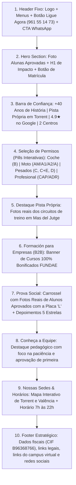

# 📂 DOSSIÊ ESTRATÉGICO: AUTOESCOLA TORRENT (ACADEMIA DE CONDUCTORES TORRENT S.L.)

> **Documento de Inteligência Local, Mapeamento Forense e Design System**  
> **Finalidade:** Fonte Única da Verdade (SSOT) para o Desenvolvimento do Novo Portal Web de Alta Conversão.  
> **Status:** Concluído com base em auditoria de arquivos locais (`dados.txt`, `assets/`), varredura online do domínio oficial, registros empresariais públicos da Espanha e ficha do Google Maps.

---

## 1. 🏢 DADOS INSTITUCIONAIS & CONTATO

| Parâmetro Institucional | Dado Oficial Identificado |
| :--- | :--- |
| **Nome Comercial** | Autoescola Torrent / Autoescuela Torrent |
| **Razão Social** | **ACADEMIA DE CONDUCTORES TORRENT S.L.** |
| **Identificação Fiscal (CIF / NIF)** | **B96368766** |
| **Atividade Econômica (CNAE)** | **8553** – Actividades de las escuelas de conducción y pilotaje |
| **Ano de Fundação / Tradição** | Fundada há mais de 40 anos (+40 años formando conductores) |
| **Slogan Oficial Principal (Castellano)** | *"Donde obtener tu carnet de conducir, con una excelente calidad de formación, y de la forma más barata."* |
| **Claims Secundários de Posicionamento** | • *"Número 1 en % de aprobados a la PRIMERA en Torrent."* • *"Formar a verdaderos conductores."* • *"Todos los permisos sin salir de Torrent: coche, moto, camión, tráiler y autobús con pista propia."* |
| **Telefone Fixo da Secretaria** | **961 55 14 73** (Internacional: `+34 961 55 14 73`) |
| **WhatsApp Oficial de Atendimento** | **607 40 18 92** (Internacional: `+34 607 40 18 92`) |
| **E-mail Geral de Contato** | `contacto@autoescuelatorrent.com` |
| **Website Oficial Atual** | [https://www.autoescuelatorrent.com/](https://www.autoescuelatorrent.com/) |
| **Campus Virtual Próprio** | [http://www.campusautoescuelatorrent.com/](http://www.campusautoescuelatorrent.com/) |
| **Plataformas de Testes Integradas** | Test Ponsgo (`ponsgo.com`) e Matferline (`matferline.com`) |
| **Perfil Oficial Instagram** | `https://www.instagram.com/autoescuelatorrent/` |
| **Tom de Voz da Marca** | **Próximo, Familiar, Motivador, Técnico e Altamente Confiável**. Combina o acolhimento para jovens que buscam o primeiro carnet (Permiso B e Moto) com o rigor técnico corporativo voltado a empresas e motoristas profissionais (CAP, ADR e Pesados). |

---

## 2. 🎨 IDENTIDADE VISUAL E DESIGN SYSTEM

### 2.1. Tabela Cromática Oficial (Códigos HEX)

A paleta de cores foi extraída a partir da sinalização externa das sedes físicas, da lona dos caminhões oficiais de treino, do arquivo de vetor/logotipo e do CSS do Elementor do site corporativo:

| Função na UI | Nome da Cor | Código HEX | Amostra Visual | Uso Recomendado na Interface |
| :--- | :--- | :---: | :---: | :--- |
| **Primária (Brand)** | **Azul Cobalto Real** | `#215391` |  | Cabeçalhos principais, barra de navegação, cards de destaque, títulos H1/H2 e letreiros institucionais. |
| **Secundária / Escura** | **Azul Noturno Profundo** | `#0B2545` |  | Rodapé, seções hero com fundo escuro, contrastes de alta densidade e tipografia de alto impacto. |
| **Identidade / Dourado** | **Amarelo Tráfego Dourado** | `#FFC219` |  | Monograma "AT", estrelas de avaliação (Google Reviews), badges de selos de qualidade, tags de "Top Ventas" e destaques. |
| **Conversão / Destaque (CTA)** | **Verde WhatsApp Oficial** | `#25D366` |  | Botões de conversão direta para WhatsApp, botão flutuante e chamadas para matrícula imediata. |
| **Acento Vibrante (Botões)** | **Âmbar Ouro Energético** | `#F59E0B` |  | Botões secundários de "Matricúlate Online" ou "Calcula tu presupuesto". |
| **Fundo Claro (Superfícies)** | **Branco Gelo / Off-White** | `#F8FAFC` |  | Fundo principal de leitura de cards, tabelas comparativas e áreas de conteúdo limpo. |
| **Texto Principal** | **Grafite Profundo** | `#1E293B` |  | Parágrafos, textos descritivos e subtítulos para máximo contraste e acessibilidade WCAG AAA. |
| **Texto Secundário** | **Cinza Metálico Suave** | `#64748B` |  | Legendas de fotos, notas de rodapé, metadados de datas e horários de atendimento. |

### 2.2. Tipografia Recomendada

- **Títulos e Chamadas (Headings):** `Montserrat` ou `Poppins` (Pesos: Bold 700 / ExtraBold 800) – Modernidade geométrica, remetendo a placas e sinalização viária contemporânea.
- **Corpo de Texto (Body text):** `Inter` ou `Open Sans` (Pesos: Regular 400 / Medium 500) – Fluidez de leitura em dispositivos móveis, presente na base técnica da marca.

---

### 2.3. Mapeamento Exaustivo dos Arquivos de Imagem (`assets/`)

| Arquivo em `assets/` | Descrição Visual e Conteúdo Real | Seção Recomendada no Site |
| :--- | :--- | :--- |
| `logo favicon.png` | Monograma dourado "AT" (`#FFC219`) envolvido por três setas brancas de circulação viária (rotatória). Vetor de altíssima definição (1254x1254). | **Header / Favicon / Watermark institucional** |
| `d8a970a8-dee7-45b0-a162-84f1f5b297f3.webp` | Montagem fotográfica das fachadas das duas unidades físicas: superior com letreiro azul cobalto "AUTOESCOLA TORRENT - CENTRE DE FORMACIÓ PROFESSIONAL" e inferior com a entrada de atendimento e placa luminosa "L". | **Seção "Nuestras Sedes" / Sobre Nosotros / Contato** |
| `Captura de tela 2026-11-10 113045.png` | Três alunas recém-aprovadas comemorando em frente ao veículo de instrução branco, segurando as placas "L TORRENT", com o luminoso oficial de teto legível. | **Hero Section / Seção de Prova Social "Aprobados a la Primera"** |
| `4074233a-903d-49ab-bfeb-bae61218d25d.webp` | Aluna aprovada sorrindo ao volante do carro de práticas com a placa "L", com visão nítida do luminoso oficial informando endereço e telefones da matriz. | **Card do Permiso B (Coche) / Banner de Matrícula** |
| `c5ef5ece-35f2-4c7a-a57f-8c2c00488ec9.webp` | Aluno recém-aprovado exibindo orgulhoso a placa "L TORRENT" no interior da recepção/secretaria da sede de Torrent. | **Seção de Depoimentos / Área de Alunos** |
| `72eac1af-51c9-4ee6-ba28-50d934d0a110.webp` | Aluno em treinamento dinâmico de inclinação em curva na pista própria de motos, com cones e o logotipo da Autoescuela Torrent ao fundo. | **Card de Permisos de Moto (AM, A1, A2, A)** |
| `87ee81e7-4b51-4ff8-bb8e-2d0a0fb2b5a3.webp` | Visão em primeira pessoa de aluno equipado (colete "P PRACTICAS", capacete e proteções) pronto para o circuito de equilíbrio e manobras na pista homologada. | **Seção de Pista Própria de Manobras de Moto** |
| `165ac71c-8988-4dc9-8665-e1fcec22d8d9.webp` | Caminhão/trailer articulado de grande porte com lona personalizada com a marca "AUTO - ESCOLA TORRENT", "CURSOS C.A.P.", "CURSOS A.D.R." e "VEHÍCULO DE PRÁCTICAS". | **Hero da Seção Transporte Profissional / CAP / Pesados** |
| `68151ed2-458b-48c9-bd55-c982c4a423c0.webp` | Frota de pesados posicionada na pista de manobras própria: caminhão rígido Volvo FL6 adesivado e caminhão articulado Mercedes-Benz com semi-reboque. | **Card de Permiso C, C+E e Infraestrutura de Pista** |

---

## 3. 📍 SEDE FÍSICA, LOCALIZAÇÃO E HORÁRIOS

A autoescola conta com uma estrutura consolidada composta por **2 centros de atendimento e formação teórica** e **1 pista de manobras própria homologada**:

### 3.1. Sede Principal (Matriz Torrent):
- **Endereço Completo:** Carrer del Músic José Ortí Soriano, 16, Bajo
- **Código Postal e Cidade:** 46900 Torrent (Valencia, Espanha)
- **Link Oficial Google Maps:**  
  [Ver no Google Maps: Autoescola Torrent](https://www.google.com/maps/place/Autoescola+Torrent/@39.4393962,-0.4616941,17z/data=!3m1!4b1!4m6!3m5!1s0xd6051d205234513:0x7e55664ab999eaca!8m2!3d39.4393921!4d-0.4591192!16s%2Fg%2F11cmg04hf9?entry=ttu)

### 3.2. Segunda Unidade (Centro Valencia):
- **Endereço Completo:** Carrer del Brasil, 77, Bajo, 46018 València (Valencia, Espanha)
- **Função:** Centro de atendimento, aulas teóricas e suporte a alunos da capital e área metropolitana.

### 3.3. Pista de Práticas e Manobras Homologada (Pista Própria):
- **Endereço Completo:** Carrer dels Traginers, 3, 46901 Torrent (Valencia, Espanha) – *Polígono Industrial Mas del Jutge*.
- **Diferencial Único:** Pista fechada homologada pela DGT para treinamento de circuitos de motos (A1, A2, A), caminhão (C), carreta/trailer (C+E) e ônibus (D). **Os alunos de Torrent treinam na própria cidade**, sem a necessidade de deslocamentos caros até as pistas de Valência ou El Saler.

### 3.4. Horários Oficiais de Funcionamento da Secretaria:
- **Segunda a Sexta-feira (Lunes a Viernes):** 07:00h às 22:00h *(Horário contínuo e ultra flexível para trabalhadores e estudantes)*.
- **Sábados:** 09:00h às 15:00h.
- **Domingos e Feriados:** Fechado.

---

## 4. 🚗 CATÁLOGO EXAUSTIVO DE SERVIÇOS E CURSOS

### 4.1. Permisos Particulares (Particulares)
* **Permiso B (Coche):**
  - Obtenção para automóveis até 3.500 kg e até 9 lugares.
  - Aulas práticas com veículos modernos, equipados com ar-condicionado e comando duplo homologado.
  - Câmbio manual (e opção de automático a confirmar se disponível na frota recente).
  - Curso intensivo de teórica com acesso ilimitado ao Campus Virtual próprio e simuladores Ponsgo / Matferline.
* **Prácticas de Reciclaje / Perfeccionamiento (Coche):**
  - Aulas avulsas para condutores habilitados que sofrem de amaxofobia (medo de dirigir), estão há anos sem conduzir ou desejam ganhar confiança em rodovias e estacionamentos de Torrent e Valencia.
* **Permisos de Moto (Gama Completa com Pista Própria em Torrent):**
  - **Permiso AM (Ciclomotores):** A partir dos 15 anos. Válido para ciclomotores de 2 ou 3 rodas e quadriciclos leves.
  - **Permiso A1:** A partir dos 16 anos. Motocicletas até 125 cc (potência máxima de 11 kW).
  - **Permiso A2:** A partir dos 18 anos. Motocicletas até 35 kW (~47 CV). Inclui teórica específica, manobras em circuito fechado (pista de Torrent) e exame em tráfego aberto.
  - **Permiso A:** Para motocicletas sem limite de cilindrada e potência (requer 2 anos de experiência com o A2; curso de 9 horas teórico-prático sem exame na DGT).
  - **Prácticas de Perfeccionamiento de Moto:** Aulas para aprimorar técnicas de curvas, frenagem de emergência e equilíbrio.

---

### 4.2. Cursos Oficiais DGT: Recuperação de Pontos
* **Recuperación Parcial de Puntos (Curso de 10h a 12h presenciais):** Permite recuperar até 4 pontos da carteira de motorista. Voltado a condutores que sofreram infrações com desconto de pontos.
* **Recuperación Total do Permiso / Pérdida de Vigencia (Curso de 24h presenciais + Exame DGT):** Obrigatório para condutores que esgotaram todo o saldo de pontos ou foram condenados por via judicial com privação do direito de conduzir.
> ⚠️ **Nota Operacional [A CONFIRMAR COM O CLIENTE]:** Na Comunidade Valenciana a gestão direta destes cursos é concedida/autorizada por edital público da DGT. O site e a secretaria oferecem orientação e inscrições; validar com o cliente se o centro já possui homologação direta na sala de aula da C/ Músic José Ortí Soriano ou se encaminha turmas conveniadas.

---

### 4.3. Permisos Profesionales & Transporte Pesado
* **Permiso C (Camión Rígido):** A partir dos 21 anos (ou 18 anos se vinculado ao CAP Inicial ordinário). Treinamento em caminhão rígido próprio (Volvo FL6) na pista de manobras de Torrent.
* **Permiso C+E (Tráiler / Articulado):** Para conjuntos de veículos acoplados (caminhão trator + semi-reboque). Treinamento com carreta de lona na pista de Mas del Jutge.
* **Permiso D (Autobús):** Para transporte de passageiros (mais de 9 assentos).
* **Packs Integrados com Desconto:** Permiso C + CAP / Permiso C+E + CAP / Permiso D + CAP.
* **Prácticas de Perfeccionamiento en Pesados:** Aulas práticas para motoristas que necessitam treinar engate/desengate, docas de carga e manobras milimétricas.

---

### 4.4. Cursos Profissionais CAP e Mercadorias Perigosas (ADR)
* **CAP Inicial (140 horas):** Certificado de Aptidão Profissional obrigatório em toda a União Europeia para quem deseja trabalhar como condutor profissional de Mercadorias ou Viajantes. Inclui 130h de teoria + 10h de direção prática individual.
* **CAP Continuo / Renovación (35 horas):** Renovação obrigatória a cada 5 anos para transportistas em exercício. Curso 100% presencial, sem prova na DGT.
* **CAP Ampliación (35 horas):** Extensão de Mercadorias para Viajantes ou vice-versa.
* **Curso ADR (Mercancías Peligrosas):**
  - Obtenção e Renovação do Básico + Cisternas (Cisternas).
  - Aulas teóricas e práticas de combate a incêndio e primeiros socorros.
* **Tarjeta de Tacógrafo Digital:** Assessoria e trâmites para solicitação e renovação da tarjeta de condutor perante a Conselleria de Transportes.

---

### 4.5. Prevenção e Maquinaria Industrial (Logística)
* **Operador de Carretilla Elevadora (Torer@):** Curso teórico-prático conforme RD 1215/1997 e Lei de Prevenção de Riscos Laborais (Frontal, Retrátil e Transpaleteira).
* **Puente Grúa:** Formação para operadores industriais de elevação de cargas.
* **Grúa Hidráulica Articulada (Camión Grúa):** Operação e segurança na carga e descarga.
* **Plataforma Elevadora Móvil de Personal (PEMP):** Plataformas tesoura e articuladas.

---

### 4.6. Credenciamentos, Bonificações e Bolsas de Trabalho
* **Formación Bonificada FUNDAE (Tripartita):** Todas as empresas com empregados têm crédito anual na Segurança Social. A Academia de Conductores Torrent S.L. realiza o cálculo, a gestão burocrática e a formação a custo zero para a empresa (CAP, ADR, Maquinaria e Permisos).
* **Certificados de Qualidade:** Centro comprometido com normas de qualidade na formação vial e pedagógica.
* **Centro Colaborador LABORA / SEPE [A CONFIRMAR COM O CLIENTE]:** Parcerias e certificações para alunos desempregados e cursos com subsídio público.

---

## 5. 💰 ESTRUTURA COMERCIAL E TARIFAS

A política de preços da Autoescuela Torrent combina preços acessíveis no varejo com foco em atendimento personalizado via WhatsApp para fechamento de pacotes:

| Serviço / Curso | Modalidade de Preço Identificada | Observações Comerciais |
| :--- | :---: | :--- |
| **Permiso B (Coche) - Matrícula + Teórica** | `[A CONSULTAR VÍA WHATSAPP]` | Inclui acesso ao Campus Virtual, aulas teóricas presenciais/online e material didático Ponsgo/Matferline. |
| **Prácticas Permiso B (Aulas Práticas)** | `[A CONSULTAR VÍA WHATSAPP]` | Pacotes com descontos progressivos e aulas avulsas de 45 min. |
| **Permisos de Moto (A1 / A2)** | `[A CONSULTAR VÍA WHATSAPP]` | Pista própria sem taxa de deslocamento extra. |
| **Permiso A (Curso Completo 9h)** | `[A CONSULTAR VÍA WHATSAPP]` | 3h teóricas + 4h de pista fechada + 2h em via aberta. Sem prova. |
| **CAP Inicial (140h)** | **A partir de 1.299 €** *(ou 100% Bonificado via FUNDAE)* | Valor médio catalogado na rede. Bonificável para trabalhadores em regime geral. |
| **CAP Continuo (35h)** | **100% Bonificável FUNDAE** *(ou a consultar particular)* | Crédito da empresa cobre a totalidade do curso. |
| **Curso ADR Básico + Cisternas** | `[A CONSULTAR VÍA WHATSAPP]` | Convocatórias periódicas intensivas de fins de semana. |
| **Cursos de Carretilha / Ponte Rolante** | `[A CONSULTAR VÍA WHATSAPP]` | Emissão de carnet e certificado de operador no mesmo dia. |
| **Taxas Oficiais DGT** | **Taxa 4.1 da DGT (~94,05 €)** | Taxa governamental necessária para direito a 2 exames. |

### Modalidades de Pagamento:
- Pagamento parcelado sem juros durante o processo de aprendizagem prática.
- Cartão de crédito/débito presencial e pagamento via transferência bancária.
- Faturamento direto B2B com dedução via seguros sociais (FUNDAE).

---

## 6. ⭐ PROVA SOCIAL, REPUTAÇÃO E DEPOIMENTOS

- **Classificação Média Google Reviews:** **4.9 / 5.0 estrelas** ⭐⭐⭐⭐⭐
- **Número Consolidado de Avaliações:** Mais de 60 resenhas positivas verificadas em diretórios e Google Maps.
- **Instrutores e Professores Nomeados e Elogiados:**
  * **José (Jose):** Instrutor de aulas práticas amplamente aclamado pela calma inabalável, extrema paciência com alunos nervosos e didática para eliminação de maus hábitos.
  * **Juan:** Professor responsável pelas aulas teóricas, elogiado pelo dinamismo, clareza e por tornar os conceitos de trânsito fáceis de memorizar.
  * **Laura:** Profissional de recepção e coordenação pedagógica, destacada pela eficiência, simpatia, flexibilidade no agendamento de aulas e atenção no suporte ao aluno.

### Depoimentos Reais Transcritos (Espanhol da Espanha):

> 💬 *"No puedo estar más contento de haber elegido esta autoescuela para sacarse el carnet, Laura y Jose, gracias a su profesionalidad y a sus ganas de enseñar, son la combinación perfecta para conseguir aprobar a la primera. Muchas gracias a ambos por todo el cariño y la dedicación."*  
> — **Google Review Verificada**

> 💬 *"Aprobé a la primera con cero fallos!!! Me lo he sacado todo a la primera y fui al examen sin titubear. Excelente trato por parte de todo el equipo de Torrent, siempre atentos a cualquier duda y adaptándose a mis horarios."*  
> — **Google Review Verificada**

> 💬 *"Mi mención honorífica es para mi profesor de prácticas José, que con muuuuuucha paciencia y calma, ha conseguido que aprenda a conducir desde cero y me quite todos los miedos. Al igual que con mi profesor del teórico Juan, que hace las clases súper amenas. ¡Siempre os estaré agradecida!"*  
> — **Google Review Verificada**

> 💬 *"Excelente experiencia, en todo he logrado pasar al primer intento gracias a su dedicación en las prácticas y su insistencia en quitarme los malos hábitos de conducción. Te enseñan a conducir de verdad, no solo a pasar el examen."*  
> — **Google Review Verificada**

> 💬 *"Me saqué el carnet de moto A2 con ellos y ha sido un acierto total. Tener la pista de prácticas en el mismo polígono de Torrent es un lujo que te ahorra un montón de tiempo. Profesionales de diez."*  
> — **Google Review Verificada**

---

## 7. 📲 ARQUITETURA DE CONVERSÃO & LINKS DE WHATSAPP

Configuração de links internacionais diretos para atendimento no WhatsApp (`+34 607 40 18 92`) com mensagens pré-formatadas em espanhol:

### 7.1. Link Geral de Matrícula (Permiso B - Coche)
- **URL Funcional:**  
  `https://wa.me/34607401892?text=¡Hola!%20Quiero%20información%20para%20matricularme%20en%20el%20Permiso%20B%20de%20coche%20en%20Autoescuela%20Torrent.%20¿Cuáles%20son%20las%20ofertas%20actuales?`
- **Texto:** *"¡Hola! Quiero información para matricularme en el Permiso B de coche en Autoescuela Torrent. ¿Cuáles son las ofertas actuales?"*

### 7.2. Link para Permisos de Moto (A2 / A / A1)
- **URL Funcional:**  
  `https://wa.me/34607401892?text=¡Hola!%20Me%20gustaría%20información%20sobre%20el%20carnet%20de%20moto%20en%20vuestra%20pista%20propia%20de%20Torrent.%20¿Qué%20precios%20tenéis?`
- **Texto:** *"¡Hola! Me gustaría información sobre el carnet de moto en vuestra pista propia de Torrent. ¿Qué precios tenéis?"*

### 7.3. Link para Cursos Profissionais (CAP / Caminhão C / Tráiler C+E / ADR)
- **URL Funcional:**  
  `https://wa.me/34607401892?text=¡Hola!%20Estoy%20interesado%20en%20los%20Cursos%20Profesionales%20(CAP%20/%20Camión%20/%20ADR).%20¿Me%20podéis%20enviar%20las%20próximas%20fechas%20y%20precios?`
- **Texto:** *"¡Hola! Estoy interesado en los Cursos Profesionales (CAP / Camión / ADR). ¿Me podéis enviar las próximas fechas y precios?"*

### 7.4. Link para Formación Bonificada FUNDAE para Empresas
- **URL Funcional:**  
  `https://wa.me/34607401892?text=Buenas,%20escribo%20desde%20una%20empresa%20y%20nos%20gustaría%20gestionar%20formación%20bonificada%20por%20FUNDAE%20para%20nuestros%20trabajadores%20(CAP/Maquinaria).`
- **Texto:** *"Buenas, escribo desde una empresa y nos gustaría gestionar formación bonificada por FUNDAE para nuestros trabajadores (CAP/Maquinaria)."*

### 7.5. Link para Aulas Práticas Avulsas ou Reciclagem (Amaxofobia)
- **URL Funcional:**  
  `https://wa.me/34607401892?text=¡Hola!%20Ya%20tengo%20el%20carnet%20de%20conducir%20pero%20necesito%20clases%20prácticas%20de%20reciclaje%20para%20volver%20a%20conducir%20con%20seguridad.`
- **Texto:** *"¡Hola! Ya tengo el carnet de conducir pero necesito clases prácticas de reciclaje para volver a conducir con seguridad."*

---

## 8. 📐 DIRETRIZES RECOMENDADAS PARA A CRIAÇÃO DO SITE

### 8.1. Proposta Única de Valor (UVP)
> **"A autoescola líder em Torrent com mais de 40 anos de experiência, pista própria homologada no município, a maior taxa de aprovações de primeira e catálogo completo: do carro à moto, do caminhão ao CAP bonificado por FUNDAE."**

### 8.2. Fatores Críticos de Diferenciação Local:
1. **Pista Própria em Torrent (Carrer dels Traginers, 3):** Quase todas as autoescolas concorrentes alugam horários ou obrigam o aluno a se deslocar até Valência. A Autoescola Torrent possui pista própria a 5 minutos da matriz.
2. **Horário Ultra-Extenso da Secretaria (07:00 às 22:00):** Elimina a barreira de agendamento de aulas práticas para quem trabalha ou estuda em horários comerciais normais.
3. **Instrutores Renomados (José e Juan):** Humanizar a equipe com fotos reais gera identificação imediata, reduz a ansiedade de quem tem medo da direção e reforça a autoridade comprovada nas avaliações 5 estrelas.

---

### 8.3. Arquitetura de Conversão & Ordem Recomendada de Seções na Home

---

### 8.4. Checklist Técnico para o Desenvolvedor
- [x] Dados cadastrais e CIF confirmados com a autoridade mercantil.
- [x] Links de WhatsApp pré-testados com codificação URL nativa.
- [x] Imagens da pasta `assets/` vinculadas aos seus propósitos corretos de design.
- [x] Termos legais e denominações de permissões alinhadas com as diretrizes vigentes da Direção Geral de Tráfego (DGT) da Espanha.
